# 국문초록 {.unnumbered}

다관절 손의 파지를 자동으로 생성하고 실제 로봇에서 물체를 들어 올리는 과정은 파지의 안정성을 검증할 수 있지만, 그 결과만으로 정밀 조작을 수행할 수 있음을 보장하지는 않는다. 동일한 파지 후보를 반복 실행하더라도 물체 인식 오차, 팔과 손의 제어 오차, 손가락의 순응성, squeeze 과정의 접촉 변화와 미끄럼 때문에 손에 잡힌 물체의 자세가 달라질 수 있기 때문이다. 이러한 object-in-hand relation의 변동은 물체가 안정적으로 들려 있더라도 삽입과 같은 정밀 작업에서 위치 및 축 정렬 오차로 나타난다.

본 연구는 파지와 이송 후 삽입 직전 상태에서 물체의 실제 형상을 다중 시점 카메라로 다시 관측하고, 소켓 축에 대한 오차를 같은 시행 안에서 보정하는 정밀 삽입 파이프라인을 제안한다. 현재 시스템은 원기둥 key와 고정된 원기둥 socket을 대상으로 한다. 세션 시작 시 소켓 좌표계를 측정하고, 사전에 검증한 파지 후보로 key를 집어 이송한다. 삽입 직전에는 각 카메라 영상에서 key의 가시 영역을 분할하고 밑면 중심을 추정한 뒤, 다중 시점 기하를 이용하여 socket 좌표계의 XY 잔차를 계산한다. 잔차는 제한된 크기의 손목 Cartesian 이동으로 변환되며, 이동 후 재촬영과 재추정을 반복한다. 정렬이 완료되면 socket 축 방향으로 20 mm 삽입하고 손을 연 뒤 최종 상태를 판정한다.

Franka Research 3와 Inspire Hand, 세 대의 유효 카메라를 이용한 예비 실험에서 고정 파지 `table/0/20195`로 파지, 리프트, 이송, 폐루프 정렬, 20 mm 삽입과 release를 연속 실행하였다. 단일 시점 대응 오류가 포함된 최초 추정치는 정량 분석에서 제외하였다. 두 시점 추정이 성립한 이후 관측된 XY 잔차는 14.59 mm에서 1.61 mm로 감소했으며, 최종 clear-view 영상에서 key가 socket 내부에 위치함을 사람이 확인하였다. 이 결과를 바탕으로 고정 grasp와 socket pose에서 반복 실험을 수행하여 손목 오차와 object-in-hand 오차를 분리하고, open-loop와 closed-loop의 삽입 성공률 및 tip-entry 성공률을 비교할 예정이다. 또한 손가락에 의한 가림에 강건하도록 단일 끝점 대신 가시 key contour와 축을 socket 형상에 정합하는 partial-shape visual servoing을 검토한다.

**주요어:** 정밀 삽입, 다중 시점, 시각 피드백, 물체-손 관계, 시각 서보잉, 로봇 조작

\newpage

# 제 1 장 서론

## 제 1 절 연구 배경

자동화된 파지 파이프라인은 물체의 3차원 형상으로부터 다수의 손 자세를 생성하고, 충돌 및 물리 시뮬레이션을 거쳐 후보를 선별한 뒤, 실제 로봇에서 파지와 리프트의 성공 여부를 반복적으로 검증할 수 있다. 이 흐름은 “물체를 안정적으로 집어 들 수 있는가”를 평가하는 데 효과적이다. 그러나 정밀 삽입에서는 파지 안정성 외에 물체의 실제 위치와 축 방향이 목표와 충분히 일치해야 한다.

같은 파지 후보와 같은 목표 손목 자세를 사용하더라도 실제 key의 자세는 매번 같지 않을 수 있다. 첫째, tabletop key pose의 인식 오차가 파지 접근 위치에 반영된다. 둘째, 로봇 관절 및 손가락의 위치 제어 오차가 존재한다. 셋째, squeeze 과정에서 손가락과 물체의 접촉이 변하고, 물체가 손 안에서 회전하거나 미끄러질 수 있다. 넷째, 이송 중 중력과 가속도에 의해 object-in-hand relation이 추가로 변할 수 있다. 단순 리프트 성공 판정은 이러한 오차를 드러내지 못한다.

본 연구의 핵심 관찰은 삽입 직전의 손목 target을 명목상 고정하더라도 실제 key pose에는 변동이 나타날 수 있다는 점이다. 따라서 삽입 직전 영상을 다시 관측해 실제 key와 socket의 상대 정렬을 보정해야 한다. 이는 미리 계산한 open-loop trajectory를 재생하는 문제라기보다, 시각 관측과 작은 손목 이동을 반복하는 visual servoing 문제로 보는 것이 타당하다. Visual servoing은 영상 특징을 제어 루프 안에 포함해 로봇 운동을 보정하는 고전적인 방법론이며, 본 연구는 이를 다중 시점 원기둥 삽입에 맞게 구성한다 [1].

## 제 2 절 연구 질문

본 연구는 다음 질문을 다룬다.

1. 고정된 grasp candidate와 socket pose를 사용할 때도 pre-insertion에서 관측되는 key pose가 반복 시행 간 달라지는가?
2. 이 변동에서 팔/손목 pose 오차와 object-in-hand relation 오차를 구분하여 분석할 수 있는가?
3. 삽입 직전 다중 시점 영상으로 key의 상대 오차를 추정하고 같은 시행 안에서 보정하면 삽입 성공률이 향상되는가?
4. 끝점 추정이 손가락 가림에 실패할 때, key의 가시 contour와 축을 사용하는 partial-shape alignment가 더 일관된 관측을 제공하는가?

## 제 3 절 연구의 기여

현재까지의 기여는 다음과 같다.

- 세션 단위 socket 측정, key 인식, 파지, 리프트, 이송, same-trial 정렬, 삽입, release와 단계별 판정을 하나의 실행 파이프라인으로 연결하였다.
- 원기둥의 회전 대칭성을 이용하여 축 방향 yaw를 제거하고, 삽입 직전 key 밑면 중심의 socket-frame XY 오차를 제어 대상으로 정의하였다.
- 다중 카메라의 영상 분할과 끝면 추정, 카메라 ray 결합, bounded Cartesian correction, 재촬영을 반복하는 폐루프를 구현하였다.
- 실제 성공 시행의 모든 관측, 명령 이동, 실측 이동, 단계별 시간과 최종 라벨을 machine-readable 형식으로 저장하였다.
- 단일-view 대응 오류, 손가락 가림, calibration 변화가 추정에 미치는 실패 양상을 식별하였다.

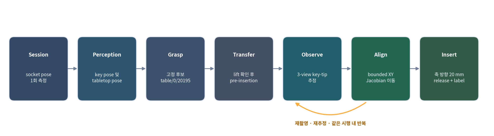{width=100%}

# 제 2 장 문제 정의와 오차 모델

## 제 1 절 좌표계와 목표

로봇 기준 좌표계를 \(B\), 손목 또는 손 좌표계를 \(H\), key 좌표계를 \(K\), socket 좌표계를 \(S\)로 둔다. 실제 key pose는 다음과 같이 표현된다.

\[
T^{B}_{K}=T^{B}_{H}(q)T^{H}_{K},
\]

여기서 \(T^{B}_{H}(q)\)는 측정된 로봇 관절값 \(q\)로부터 forward kinematics를 통해 계산할 수 있다. 반면 \(T^{H}_{K}\)는 실제 파지 후 손과 key 사이의 관계이며, 접촉과 미끄럼에 따라 명목 grasp relation과 달라질 수 있다.

동일한 grasp candidate와 socket pose를 고정하면 planning이 만드는 명목 pre-insertion end-effector target은 동일하다. 경로와 중간 관절 자세는 planner seed와 현재 상태에 따라 달라질 수 있지만, 최종 Cartesian target은 동일하게 정의된다. 따라서 매 시행에서 측정된 \(T^{B}_{H}\)까지 거의 동일한데 영상에서 key pose가 달라진다면, 그 잔차는 주로 \(T^{H}_{K}\)의 변동으로 해석할 수 있다. 반대로 손목 FK 자체가 달라졌다면 팔 제어 오차가 포함된 것이다. 두 오차는 관측 영상 하나만으로 자동 분리되지 않으므로, measured FK와 visual key pose를 함께 저장해야 한다.

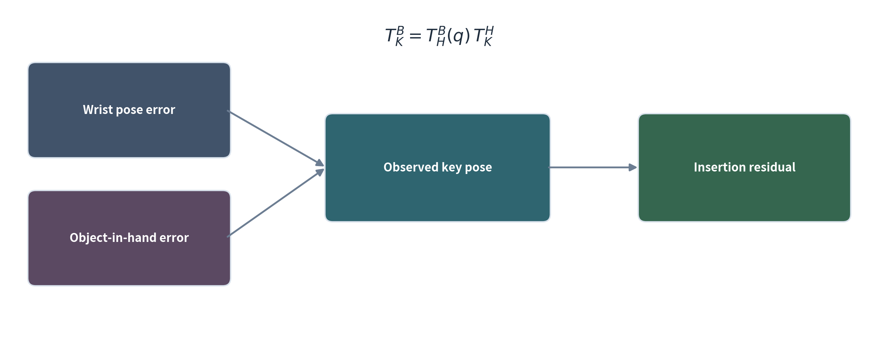{width=95%}

## 제 2 절 원기둥 삽입의 제어 변수

현재 key는 반지름 15 mm, 높이 80 mm의 원기둥이며 socket은 key보다 반지름 방향으로 5 mm 큰 bring-up 조건이다. 원기둥은 축 주위 yaw가 형상상 동등하므로 제어할 필요가 없다. 현재 구현의 주 제어 변수는 key 삽입 끝면 중심의 socket-frame XY 좌표이다.

\[
e_{xy}=\begin{bmatrix}x_{K}^{S} & y_{K}^{S}\end{bmatrix}^{T}.
\]

초기 예비 실험은 key 축이 socket 축과 평행하다고 가정하고 XY translation만 보정하였다. 이 가정은 시스템 bring-up에는 유용하지만, socket 벽과 비스듬히 접촉하는 실패를 모두 설명하지 못한다. 따라서 다음 단계에서는 key 축과 socket 축 사이의 tilt \((\theta_x,\theta_y)\)를 추가해 \([x,y,\theta_x,\theta_y]\)를 최적화할 예정이다.

# 제 3 장 시스템 설계

## 제 1 절 하드웨어와 카메라

실험에는 Franka Research 3 팔, Inspire 다관절 손, 고정된 ChArUco board, 원기둥 key 및 socket을 사용하였다. 영상은 capture4 PC에 연결된 네 대의 카메라에서 동기화해 취득한다. 성공 사례 시각화에는 `25322639`, `25322642`, `26053248` 세 시점을 사용하였다. `25305462`는 calibration 후 물리적으로 틀어진 것이 확인되어 해당 실험의 그림에서 제외하였다. 이는 특정 카메라를 영구적으로 배제하는 설계가 아니라, 해당 기록을 해석할 때 잘못된 외부 파라미터를 사용하지 않기 위한 조치이다. 재보정 후에는 네 시점 모두를 다시 평가해야 한다.

`25322642`는 key의 긴 side silhouette과 socket opening을 동시에 관찰할 수 있어 key 축의 기울기와 한 방향의 lateral displacement를 추정하기에 유리하다. `25322639`는 위에서 내려다보는 시점이므로 XY 중심에는 도움이 되지만 축 기울기 관측에는 상대적으로 불리하다. 따라서 앞으로는 고정된 camera ID 우선순위보다, 각 세션에서 가시 길이, 가림 비율, socket reprojection residual 및 camera Jacobian의 조건수를 이용해 view를 선택하는 편이 타당하다.

## 제 2 절 세션 초기화와 고정 collision world

세션 시작 시 key를 치운 상태에서 socket과 board를 촬영한다. ChArUco board로 각 영상의 기준 평면을 확인하고, socket CAD와 영상 evidence를 이용하여 \(T^{B}_{S}\)를 측정한다. Socket은 세션 동안 고정되어 있다고 가정하며, 측정된 pose와 socket collision mesh로 fixed collision world를 생성한다. 반복 시행에서는 이 값을 재사용하므로 매 시행마다 socket pose를 다시 측정하지 않는다. Socket이나 board가 물리적으로 움직인 경우에만 새 세션 측정을 수행한다.

## 제 3 절 파지와 이송

사전에 생성된 grasp candidate는 tabletop pose, 손–key 접촉 및 파지 안정성 조건을 통과하며, 추가로 key가 socket에 20 mm 정렬 삽입된 자세에서 손 geometry와 socket이 충돌하지 않아야 한다. 본 예비 실험에서는 성공 기록이 있는 `table/0/20195`를 고정하였다.

시행은 clear-view pose에서 key를 인식하는 것으로 시작한다. Planner는 현재 관절 상태에서 pre-grasp, grasp, squeeze, lift를 계획한다. Lift 뒤 2초 동안 유지한 후 영상을 촬영하고 파지 성공 여부를 판정한다. 이후 grasp relation을 planning 상 고정한 채 socket 위 pre-insertion target으로 이송한다. 이때 key가 손에서 미끄러지는 경우를 단계적으로 기록하기 위해 `grasp_success`와 `preinsert_reached`를 구분한다.

## 제 4 절 다중 시점 끝점 추정

Pre-insertion에 도달하면 각 카메라에서 다음 과정을 수행한다.

1. calibration map으로 영상을 undistort한다.
2. 명목 key projection과 socket projection을 이용하여 view별 ROI를 만든다. ROI는 고정 pixel crop이 아니라 세션 socket pose와 현재 손목 pose에 따라 매 촬영 시 계산한다.
3. Qwen 기반 visual grounding으로 key 후보 영역을 찾는다.
4. SAM 계열 segmentation으로 후보 영역의 key mask를 얻는다.
5. mask의 distal boundary에서 half-ellipse를 맞추고 key 밑면 중심의 2D 관측을 계산한다.
6. 두 시점 이상에서 대응이 일관되면 camera ray를 결합하여 3D 끝점 중심을 추정한다.
7. 한 시점만 유효한 경우에는 명목 key-tip 높이 평면과 ray의 교점을 이용하는 fallback을 사용한다.

마지막 fallback은 관측 가능성이 낮은 상태에서도 보정을 시도할 수 있게 하지만, 잘못된 영상 영역을 key로 대응시키면 큰 오차를 만들 수 있다. 성공 사례의 iteration 0에서 기록된 76.33 mm가 이에 해당하므로 실제 물리 오차로 해석하지 않는다. 정량 분석에는 두 시점의 대응이 성립한 iteration 1 이후를 사용한다.

## 제 5 절 같은 시행 내 손목 보정

추정된 끝점의 socket-frame XY 오차에 대해 다음 bounded update를 사용한다.

\[
\Delta p^{S}_{xy}=-\alpha\,e_{xy},\qquad
\lVert\Delta p^{S}_{xy}\rVert\le d_{\max}.
\]

예비 성공 시행에서 \(\alpha=1\), \(d_{\max}=3\) mm를 사용하였다. Socket-frame update는 robot frame으로 변환하고, 손목 Cartesian Jacobian의 damped least-squares inverse를 사용하여 작은 joint waypoint로 변환한다.

\[
\Delta q=J^{T}(JJ^{T}+\lambda^{2}I)^{-1}\Delta x.
\]

각 이동 후에는 실제 관절값으로 손목 이동량을 다시 계산하고 영상을 재촬영한다. 따라서 명령된 이동과 실측 이동을 비교할 수 있으며, 다음 관측은 실제 이동 결과를 기준으로 갱신된다. 성공 사례에서는 5회의 XY 이동 후 추정 잔차가 당시 허용값 2.5 mm 아래로 내려가 정렬을 종료하였다.

## 제 6 절 삽입과 라벨

정렬 후 현재 측정 관절 상태에서 socket 축 방향 20 mm insertion trajectory를 다시 계산한다. 삽입 후에는 손을 열고 축 방향으로 빠져나온 뒤 clear-view pose로 이동해 최종 영상을 촬영한다.

성공 라벨은 다음처럼 계층적으로 저장하는 것이 필요하다.

| 단계 | 라벨 | 의미 |
|---|---|---|
| 파지/리프트 | `grasp_success` | lift 촬영 시 key가 손에 들려 있음 |
| 이송 | `preinsert_reached` | key를 유지한 채 pre-insertion에 도달함 |
| 진입 품질 | `tip_entry_success` | key 끝이 socket 벽에 걸리지 않고 입구로 정상 진입함 |
| 최종 결과 | `insertion_success` | release 및 clear-view 후 key가 socket 내부에 있음 |

`tip_entry_success`를 별도로 두는 이유는 key가 벽에 눌린 뒤 손을 펴는 과정에서 우연히 socket 안으로 떨어지는 경우를 정상적인 삽입과 구분하기 위해서다. 2026년 10월 30일 성공 기록은 이 라벨이 추가되기 전의 데이터이므로 `insertion_success=true`만 확인할 수 있고, 매끄러운 tip entry까지 사후에 주장할 수는 없다.

# 제 4 장 예비 실험

## 제 1 절 실험 조건

예비 실험은 다음 조건에서 수행하였다.

- key: `precision_key_cylinder_r15_h80`
- socket: `precision_socket_cylinder_gap_05mm` (반지름 방향 gap 5 mm)
- grasp candidate: `table/0/20195`
- attempt: `attempt_3c8ff1b830d347a2b8c45aa7ae1a5363`
- session run: `20261030_222800_220645_219060`
- 유효 시각화 view: `25322639`, `25322642`, `26053248`
- 보정: XY translation, 한 iteration당 최대 3 mm
- 삽입 깊이: 20 mm
- 최종 판정: manual + saved-image label

## 제 2 절 폐루프 정렬 결과

Iteration 0의 단일-view 추정은 76.33 mm의 큰 값을 출력했다. 이는 성공적인 초기 key-tip measurement가 아니라 단일-view 대응 오류이며, 물리적인 초기 오차로 간주하지 않는다. Iteration 1에서 `25322639`와 `25322642`의 두 시점이 일관된 끝면 중심을 제공하면서 14.59 mm의 잔차로 다시 초기화되었다. 이후 실제 손목 이동을 영상 특징의 temporal correspondence와 결합해 11.03, 7.91, 4.90, 1.61 mm로 잔차가 감소하였다.

| `25322639` | `25322642` | `26053248` |
|:---:|:---:|:---:|
| 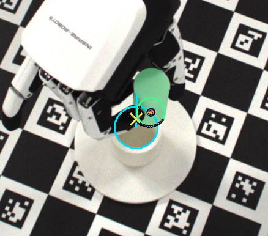 | 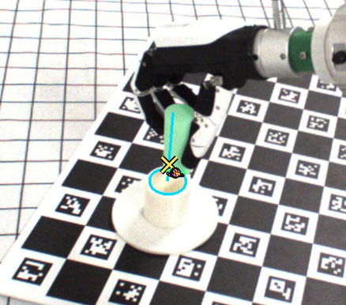 | 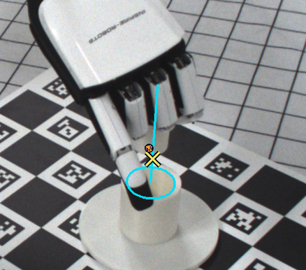 |

**그림 4-1.** 두 시점 추정이 성립한 iteration 1의 view별 관측. 청록색은 측정 socket rim/axis, 초록색은 key mask, 자홍색은 융합된 key-tip 추정이다. 원본 카메라 crop에는 관측과 직접 관계된 annotation만 표시하였다.

| `25322639` | `25322642` | `26053248` |
|:---:|:---:|:---:|
| 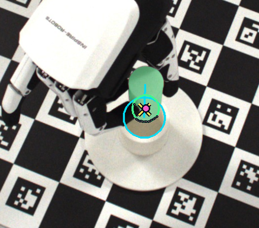 | 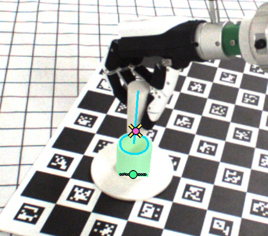 | 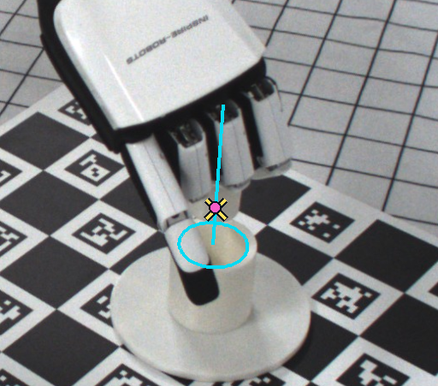 |

**그림 4-2.** 정렬 종료 시점인 iteration 5의 view별 관측. 추정 XY 잔차는 1.61 mm로 기록되었다.

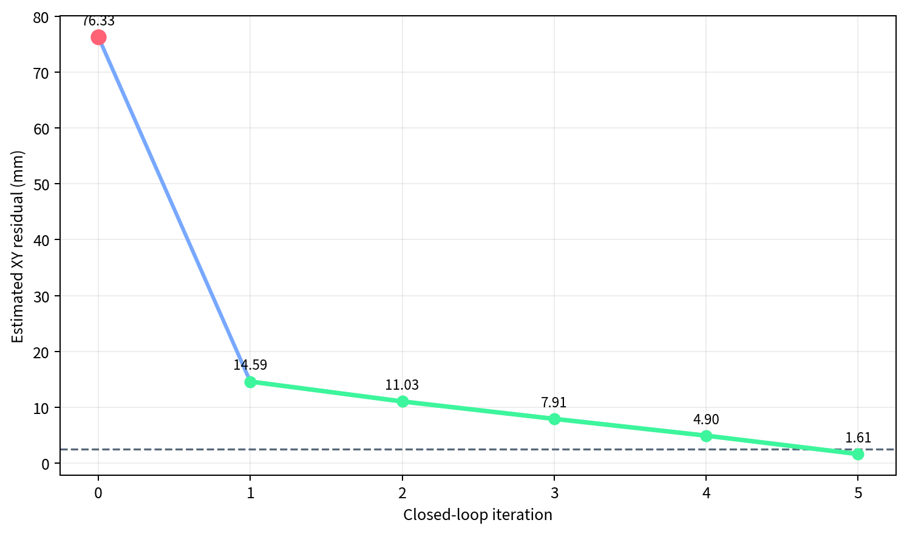{width=82%}

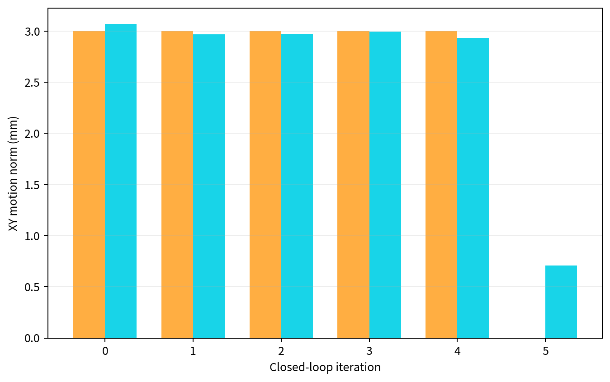{width=76%}

명령된 3 mm 이동과 measured FK로 계산한 실제 XY 이동은 각 iteration에서 유사했다. 손목 Cartesian motion은 명령을 대체로 따랐지만, 영상 잔차는 대응된 특징의 정확도에도 영향을 받는다. 향후에는 한 점의 temporal consistency뿐 아니라 가시 형상의 정합 loss가 실제 이동과 함께 감소하는지를 확인한다.

## 제 3 절 최종 삽입 결과

폐루프가 alignment 상태를 반환한 뒤 axial trajectory를 다시 계산하여 20 mm 삽입하였다. 손을 열고 clear-view로 이동한 후 세 시점 모두에서 key가 socket 내부에 있는 것이 확인되었으며, 결과 파일에는 `grasp_success=true`, `preinsert_reached=true`, `insertion_success=true`가 기록되었다.

| `25322639` | `25322642` | `26053248` |
|:---:|:---:|:---:|
| 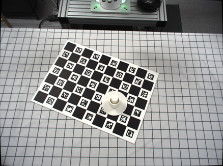 | 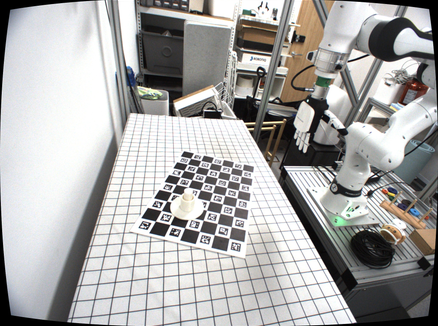 | 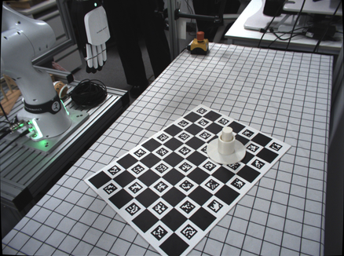 |

**그림 4-5.** Release 및 clear-view 후 저장된 카메라별 최종 성공 evidence. 세 view 모두 key가 socket 내부에 있는 상태를 보여준다.

동적 시각화는 [3-view closed-loop GIF](assets/closed_loop_success.gif)에서 확인할 수 있다.

## 제 4 절 실행 시간

해당 세션의 전체 wall time은 485.83초였으며, 이 중 336.64초는 세 차례의 수동 라벨 입력을 기다린 시간이다. 따라서 현재 전체 세션 시간은 알고리즘 latency보다 사람의 응답 지연에 크게 영향을 받는다. 주요 자동 단계의 inclusive time은 다음과 같다. Visual estimate 6회는 총 9.29초, XY motion 5회는 총 6.71초였으며, 평균적으로 관측 한 번은 약 1.55초, 미세 이동 한 번은 약 1.34초가 걸렸다.

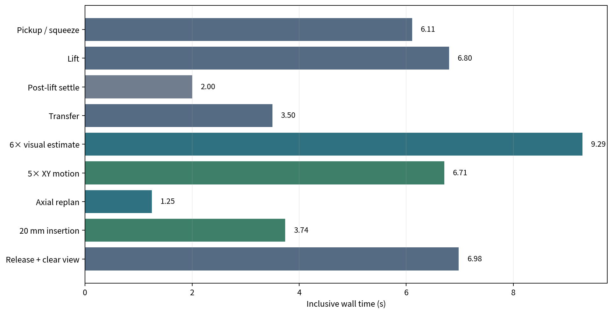{width=92%}

시간 측정은 session, planning, perception/VLM, motion, evidence write, manual wait를 계층적 span으로 기록한다. 보고 시에는 다음 원칙을 적용한다.

- 전체 wall time과 각 단계의 inclusive time을 구분한다.
- 부모–자식 span의 inclusive time을 중복 합산하지 않는다.
- 수동 라벨 대기는 알고리즘 실행 시간과 분리한다.
- 모델 load와 camera open은 세션 startup 비용으로, 반복 시행 latency와 분리한다.
- 비동기 PNG 저장과 hash 계산은 critical path 점유 시간과 누적 compute time을 분리한다.

# 제 5 장 비판적 검토

## 제 1 절 확인된 사항과 남은 질문

성공 사례에서 확인한 사항은 다음과 같다.

1. 실제 로봇에서 파지–리프트–이송–다중 시점 관측–반복 XY 손목 이동–20 mm 삽입–release–최종 판정을 하나의 시행으로 완주할 수 있다.
2. 두 시점에서 끝면 중심 대응이 성립한 뒤 관측 잔차가 반복 이동과 함께 감소했다.
3. 명령 손목 이동과 measured FK 이동이 유사하게 기록되었으며, 최종 key가 socket 내부에 있었다.

반복 실험에서 추가로 확인할 항목은 다음과 같다.

1. 폐루프 정렬이 open-loop보다 성공률을 유의하게 높인다는 통계적 결론.
2. 1.61 mm라는 영상 기반 잔차가 실제 key-tip 위치 오차와 동일하다는 주장.
3. 성공 과정에서 key 끝이 socket 벽에 닿지 않고 매끄럽게 진입했다는 주장.
4. 다른 grasp, key 시작 pose, socket 위치 및 더 작은 clearance에서도 동일하게 동작한다는 주장.

따라서 현재 결과는 전체 흐름의 실행 가능성과 주요 실패 요인을 보여주는 예비 결과로 사용하고, 성능 비교는 통제된 반복 실험으로 제시한다.

## 제 2 절 끝점 추정의 한계

현재 파이프라인은 key 밑면 중심이라는 하나의 3D feature를 주로 사용한다. 손가락이 끝면을 가리거나 SAM mask가 socket rim을 선택하면 대응이 불안정해진다. 특히 single-view ray와 명목 높이 평면의 교점은 잘못된 2D point를 metric error로 증폭시킬 수 있다. 최근 실패 사례에서는 같은 잘못된 특징을 temporal tracking하면서 socket 축에서 오히려 멀어지는 현상도 관측되었다.

이에 따라 다음 변경이 타당하다.

- 한 점만 사용하지 않고 가시 key shaft의 두 side contour, 가시 distal arc, 축 방향과 apparent width를 함께 사용한다.
- 손 mesh projection으로 손가락에 가려진 pixel을 loss에서 제외한다.
- socket CAD projection과 영상 socket rim을 같은 view에서 사용해 key–socket 상대 image residual을 계산한다.
- 원기둥 대칭성을 이용해 yaw는 제거하고 \([x,y,\theta_x,\theta_y]\)만 최적화한다.
- 각 view의 residual을 camera interaction matrix로 robot motion에 연결하고, 실제 이동 후 loss가 감소했는지 확인한다.
- `25322642`와 같이 긴 side silhouette이 보이는 view를 tilt 관측의 anchor로 사용하되 camera ID를 고정하지 않고 observability score로 선택한다.

이는 CAD 기반 contour tracking이 textureless object의 pose를 효율적으로 최적화하는 SRT3D의 흐름 [2] 및 visible part를 이용하는 segmentation-driven pose estimation [3]과 일관된다. FoundationPose는 CAD가 주어진 새로운 물체의 6D pose 초기화 및 tracking에 사용할 수 있지만 [4], 손에 심하게 가린 작은 key에 단독 적용하기보다는 optional initializer 또는 비교 기준으로 사용하는 것이 타당하다.

## 제 3 절 캘리브레이션

현재 `25305462`는 calibration 이후 카메라가 움직였기 때문에 과거 extrinsic을 그대로 사용할 수 없다. 해당 실험의 시각화에서는 이를 제외하지만, 시스템이 특정 camera ID를 영구 blacklist해서는 안 된다. 다음 실험 전에 네 대 카메라의 intrinsic, distortion map 및 board-to-camera extrinsic을 다시 측정한다. Socket-only capture에서 view별 socket 중심 및 축 residual을 계산하고, 큰 residual을 가진 view는 해당 세션의 geometry fusion에서 제외하되 원본 영상과 제외 이유는 모두 저장한다.

동일 view에서 key와 socket의 상대 image residual을 사용하는 image-based control은 공통 calibration 오차 일부를 상쇄할 수 있다. 그러나 여러 view의 residual을 robot-frame Cartesian update로 바꾸려면 camera extrinsic이 여전히 필요하므로 재보정은 생략할 수 없다.

# 제 6 장 향후 실험 계획

## 제 1 절 반복 실험 설계

최종 논문의 핵심 실험은 grasp candidate와 socket pose를 고정한 반복 시행이다. 다음 세 조건을 비교한다.

| 조건 | 방법 | 목적 |
|---|---|---|
| A | open-loop, 시각 보정 없음 | baseline 성공률과 pre-insertion 변동 측정 |
| B | 현재 key-tip XY closed-loop | 끝점 기반 translation 보정의 효과 측정 |
| C | visible-shape XY + tilt closed-loop | 가림과 축 오차에 대한 개선 검증 |

각 조건에서 최소 20회 반복하고, 가능하면 동일한 초기 tabletop pose 분포를 사용한다. 결과는 단순 최종 성공률뿐 아니라 다음 계층으로 보고한다.

- grasp/lift success rate
- transfer success rate
- smooth tip-entry success rate
- final insertion success rate
- pre-insertion 초기 XY 및 tilt residual
- 정렬 후 XY 및 tilt residual
- correction iteration 수와 누적 이동 거리
- 자동 실행 시간과 수동 대기 제외 latency

조건 간 최종 성공률은 Fisher exact test 또는 bootstrap confidence interval로 비교하고, 초기/최종 residual은 paired data가 확보되는 경우 paired non-parametric test와 effect size를 함께 보고한다. 시행 수가 적을 경우 p-value보다 개별 시행 scatter와 confidence interval을 우선 제시한다.

## 제 2 절 손목 오차와 object-in-hand 오차 분리

고정 grasp와 socket 조건에서 각 시행의 pre-insertion 데이터를 다음처럼 저장한다.

1. target wrist pose \(T^{B}_{H,target}\)
2. measured FK wrist pose \(T^{B}_{H,measured}\)
3. 다중 시점에서 측정한 key pose \(T^{B}_{K,visual}\)
4. 명목 grasp relation \(T^{H}_{K,nominal}\)

손목 pose 오차는 \(T^{B}_{H,target}\)와 \(T^{B}_{H,measured}\)의 차이로 계산한다. 명목 relation으로 예측한 key pose는 \(T^{B}_{H,measured}T^{H}_{K,nominal}\)이며, 이를 visual key pose와 비교한 잔차를 object-in-hand relation variation의 근사치로 사용한다. 이 분리는 정확한 ground-truth를 제공하지는 않지만, 최종 key pose 변동이 팔의 repeatability 때문인지 파지 후 관계 변화 때문인지 분석하는 데 더 논리적인 근거를 제공한다.

## 제 3 절 단기 구현 계획

1. 네 카메라를 재보정하고 session별 socket reprojection residual을 저장한다.
2. `25305462`를 재평가하고, view selection을 고정 ID가 아닌 observability score로 전환한다.
3. 성공/실패 기록 전체에 대해 key-tip mask와 correspondence를 수동 검토하여 endpoint estimator의 precision을 측정한다.
4. partial-shape loss의 offline replay를 구현하여 `25322642` 및 보조 view에서 XY와 tilt를 추정한다.
5. 현재 endpoint estimator와 shape estimator를 동일 저장 episode에서 비교한다.
6. 실시간 루프에는 offline replay에서 일관된 방법만 연결한다.
7. 고정 grasp `table/0/20195`로 A/B/C 반복 실험을 수행한다.
8. 작은 clearance 조건으로 이동하기 전에 5 mm 조건에서 smooth tip-entry 성공률을 확보한다.

# 제 7 장 결론

본 연구는 안정적인 파지 이후에도 남는 object-in-hand 오차를 삽입 직전 시각 피드백으로 보정하는 파이프라인을 구현하였다. 실제 성공 사례에서 두 시점 추정 이후 관측된 XY 잔차가 14.59 mm에서 1.61 mm로 감소했고, 20 mm 삽입과 release 뒤 key가 socket 내부에 위치했다. 동시에 single-view 대응 오류와 손가락 가림이 끝점 추정을 잘못 유도하는 실패 양상도 확인하였다. 다음 단계에서는 고정 조건 반복 실험으로 wrist pose error와 object-in-hand relation error를 분리하고, open-loop, 끝점 기반 closed-loop, partial-shape 기반 closed-loop를 비교한다.

# 참고문헌 {.unnumbered}

[1] F. Chaumette and S. Hutchinson, “Visual Servo Control. I. Basic Approaches,” *IEEE Robotics & Automation Magazine*, vol. 13, no. 4, pp. 82–90, 2006. DOI: 10.1109/MRA.2006.250573.

[2] M. Stoiber, M. Pfanne, K. H. Strobl, R. Triebel, and A. Albu-Schäffer, “SRT3D: A Sparse Region-Based 3D Object Tracking Approach for the Real World,” *International Journal of Computer Vision*, 2022. arXiv:2110.12715.

[3] Y. Hu, J. Hugonot, P. Fua, and M. Salzmann, “Segmentation-Driven 6D Object Pose Estimation,” *Proceedings of CVPR*, 2019.

[4] B. Wen, W. Yang, J. Kautz, and S. Birchfield, “FoundationPose: Unified 6D Pose Estimation and Tracking of Novel Objects,” *Proceedings of CVPR*, pp. 17868–17879, 2024.

\newpage

# Abstract {.unnumbered}

## Same-Trial Precision Insertion Alignment via Multi-View Visual Feedback {.unnumbered}

Automated grasp validation can determine whether a dexterous hand can pick up and lift an object, but lift success alone does not guarantee sufficient accuracy for precision insertion. Even with a fixed grasp candidate and socket pose, perception error, wrist control error, compliant finger contact, squeezing, and in-hand slip can alter the actual object-in-hand relation. This work develops a same-trial precision insertion pipeline that re-observes the held object at a pre-insertion pose and corrects the wrist before insertion.

The current system uses a cylindrical key and a fixed cylindrical socket. The socket pose is measured once at the beginning of a session. A prevalidated grasp is used to pick, lift, and transfer the key. At the pre-insertion pose, the visible key region is segmented in multiple camera views, the center of the distal face is estimated, and the key-tip position is reconstructed in the socket frame. A bounded Cartesian correction is executed through a damped Jacobian update, followed by recapture and re-estimation. Once alignment is reached, the robot executes a 20 mm axial insertion, releases the key, moves to a clear-view pose, and records the final outcome.

In a preliminary physical trial using a fixed grasp (`table/0/20195`), the pipeline completed grasping, lifting, transfer, closed-loop alignment, insertion, release, and final observation. An initial single-view correspondence failure was excluded from quantitative interpretation. After a consistent two-view estimate became available, the observed XY residual decreased from 14.59 mm to 1.61 mm, and the released key was visually confirmed inside the socket. This trial demonstrates end-to-end executability, but it does not establish a statistically significant success-rate improvement. Future work will separate wrist-pose error from object-in-hand variation through measured forward kinematics and multi-view pose estimates, compare open-loop and closed-loop insertion over repeated trials, and replace point-only tip estimation with occlusion-aware partial-shape alignment.

**Keywords:** precision insertion, multi-view vision, visual feedback, object-in-hand relation, visual servoing, robotic manipulation

